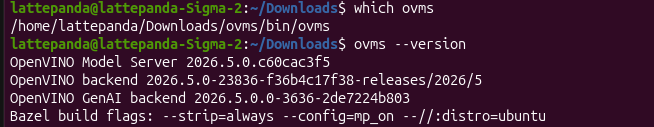
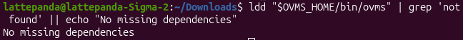
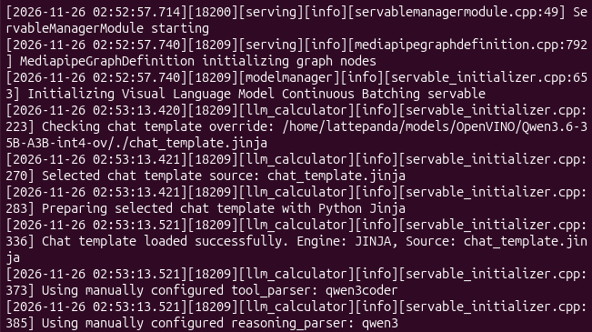
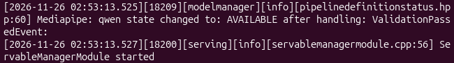
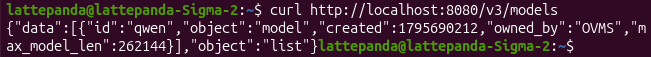

# Local OVMS Deployment

Set up the local AI API on LattePanda Sigma 2 after reinstalling Ubuntu. This guide installs [OpenVINO Model Server (OVMS)](https://docs.openvino.ai/nightly/model-server/ovms_docs_deploying_server_baremetal.html) and deploys the Qwen3.6-35B-A3B INT4 OpenVINO model on the GPU.

## Prerequisites

- Ubuntu 26.04 LTS, or Ubuntu 24.04.4 or later with the HWE kernel. See [Kernel Requirement](os_linux.md#kernel-requirement).
- Working [Intel GPU Compute Driver](os_linux.md#intel-gpu-compute-driver) and membership in the `render` group.
- Internet access and sufficient disk space to download OVMS and the model.

!!! note "Tested Configuration"
    Tested on Sigma 2 with Ubuntu 26.04.1 and kernel `7.0.0-44-generic`. The Ubuntu 24.04 instructions use the corresponding Intel packages and dependencies, but were not independently verified in this Sigma 2 test.

## Install OVMS

1. **Install System Dependencies**

    Select your Ubuntu version:

    === "Ubuntu 24.04"

        ```bash
        sudo apt update
        sudo apt install -y curl ca-certificates libxml2
        ```

    === "Ubuntu 26.04"

        ```bash
        sudo apt update
        sudo apt install -y curl ca-certificates libxml2-16
        ```

2. **Download and Extract OVMS**

    Download the package for your Ubuntu version from the [official OVMS releases](https://github.com/openvinotoolkit/model_server/releases). The examples below install OVMS in `~/Downloads/ovms/`.

    === "Ubuntu 24.04"

        Use the released `python_off` package:

        ```bash
        mkdir -p ~/Downloads
        cd ~/Downloads
        curl -fL https://github.com/openvinotoolkit/model_server/releases/download/v2026.4.1/ovms_ubuntu24_2026.4.1_python_off.tar.gz -o ovms_ubuntu24.tar.gz
        tar -xzf ovms_ubuntu24.tar.gz
        ```

    === "Ubuntu 26.04"

        !!! note
            No Ubuntu 26.04 release package was available when tested in November 2026. The commands below use `weekly/latest`; the tested build was `2026.5.0.c60cac3f5`, and later downloads may differ.

        ```bash
        mkdir -p ~/Downloads
        cd ~/Downloads
        curl -fL https://storage.openvinotoolkit.org/repositories/openvino_model_server/packages/weekly/latest/ovms_ubuntu26.tar.gz -o ovms_ubuntu26.tar.gz
        tar -xzf ovms_ubuntu26.tar.gz
        ```

3. **Configure the Environment**

    Run in the terminal you will use to start OVMS:

    ```bash
    unset LD_LIBRARY_PATH

    export OVMS_HOME="$HOME/Downloads/ovms"
    export PATH="$OVMS_HOME/bin:$PATH"
    export LD_LIBRARY_PATH="$OVMS_HOME/lib"
    ```

4. **Verify the Installation**

    ```bash
    which ovms
    ovms --version
    ```

    The executable should be `~/Downloads/ovms/bin/ovms`:

    {width="600"}

    After `ovms --version` succeeds, check for missing library dependencies:

    ```bash
    ldd "$OVMS_HOME/bin/ovms" | grep 'not found' || echo "No missing dependencies"
    ```

    The expected result is `No missing dependencies`:

    {width="600"}

!!! note "Optional Python Integration"
    On Ubuntu 24.04, Python features require the matching `python_on` package and its [setup instructions](https://github.com/openvinotoolkit/model_server/blob/v2026.4.1/docs/deploying_server_baremetal.md). On Ubuntu 26.04, install `python3 libpython3.14 python3-jinja2` using `sudo apt install -y` when Jinja templates or Python custom nodes are needed. OVMS already includes its OpenVINO components; no separate OpenVINO installation is needed.

## Deploy the LLM

1. **Prepare the Model Directory**

    ```bash
    mkdir -p ~/models
    ```

2. **Download the Model and Start OVMS**

    ```bash
    ovms --rest_port 8080 \
         --model_repository_path "$HOME/models" \
         --source_model OpenVINO/Qwen3.6-35B-A3B-int4-ov \
         --model_name qwen \
         --reasoning_parser qwen3 \
         --tool_parser qwen3coder \
         --target_device GPU \
         --task text_generation
    ```

    OVMS downloads the [OpenVINO model](https://huggingface.co/OpenVINO/Qwen3.6-35B-A3B-int4-ov) to `~/models/OpenVINO/Qwen3.6-35B-A3B-int4-ov`, loads it on the GPU, and starts the API on port `8080`:

    {width="600"}

    Wait until the log reports `qwen` as `AVAILABLE`:

    {width="600"}

    !!! note
        The first startup can take longer while the model downloads and the GPU compiles it. Keep this terminal open during API verification.

## Verify the Local AI API

Open another terminal.

1. **List Available Models**

    ```bash
    curl http://localhost:8080/v3/models
    ```

    The response should include `qwen`.

    {width="600"}

2. **Send a Chat Request**

    ```bash
    curl http://localhost:8080/v3/chat/completions \
      -H "Content-Type: application/json" \
      -d '{
        "model": "qwen",
        "messages": [{"role": "user", "content": "Hello, please introduce yourself."}],
        "max_tokens": 200
      }'
    ```

    A response containing the model's answer confirms that the local API is working.

    <!-- Screenshot: POST /v3/chat/completions response -->

Use these settings to connect an application. For agent setup, see [Other AI Agents](local_ai_agents.md).


## Start/Stop OVMS from Desktop

1. **Stop the Foreground Service**

    After verifying the API, press `Ctrl + C` in the terminal running OVMS.

2. **Download the Scripts and Shortcuts**

    Save all four files to your Home folder (`~`), keeping their filenames:

    | Download | Purpose |
    | :--- | :--- |
    | [start-ovms-api.sh](../../assets/scripts/sigma2_edition/start-ovms-api.sh){download="start-ovms-api.sh"} | Start OVMS with the downloaded model and wait for the API |
    | [stop-ovms-api.sh](../../assets/scripts/sigma2_edition/stop-ovms-api.sh){download="stop-ovms-api.sh"} | Stop the OVMS process recorded by the start script |
    | [start-ovms-api.desktop](../../assets/scripts/sigma2_edition/start-ovms-api.desktop){download="start-ovms-api.desktop"} | Start OVMS API desktop shortcut |
    | [stop-ovms-api.desktop](../../assets/scripts/sigma2_edition/stop-ovms-api.desktop){download="stop-ovms-api.desktop"} | Stop OVMS API desktop shortcut |

3. **Enable the Desktop Shortcuts**

    ```bash
    chmod +x ~/start-ovms-api.sh ~/stop-ovms-api.sh \
        ~/start-ovms-api.desktop ~/stop-ovms-api.desktop
    ```

    Move the two `.desktop` files to your Desktop folder. Right-click each one and select **Allow Launching**. Keep the `.sh` files in your Home folder.

4. **Start or Stop OVMS**

    Double-click **Start OVMS API**. The script loads the existing local model and checks the API for up to five minutes. When it shows **OVMS is ready**, the API is available at `http://localhost:8080/v3`. OVMS continues running in the background after you close the terminal window.

    Double-click **Stop OVMS API** to stop that instance. Each shortcut keeps its terminal open so you can read the result.

    <!-- Screenshot: Start OVMS API and Stop OVMS API desktop shortcuts and terminal results -->

    !!! note
        These shortcuts manage the OVMS process they start. If OVMS was started in another terminal, stop it there first. A startup timeout is not a success message; check the log before retrying.

    | File | Purpose |
    | :--- | :--- |
    | `~/ovms.log` | OVMS startup and runtime log |
    | `~/.ovms-api.pid` | Process ID and start time used to identify this OVMS instance |

## Troubleshooting

- **libxml2 is missing or incompatible** - use the OVMS package matching your Ubuntu version: `ovms_ubuntu24.tar.gz` with `libxml2`, or `ovms_ubuntu26.tar.gz` with `libxml2-16`. Do not link one libxml2 version to another.
- **OVMS is not found or the wrong version runs** - check `which ovms` and `ovms --version`. The executable should be `~/Downloads/ovms/bin/ovms`.
- **Old environment variables cause library errors** - run `export LD_LIBRARY_PATH="$HOME/Downloads/ovms/lib"`, then check `ldd "$HOME/Downloads/ovms/bin/ovms"` for missing dependencies.
- **Download fails with a TLS error** - retry the download command with `--retry 5 --retry-all-errors`. If it still fails, check your network and proxy settings.
- **Port 8080 is occupied** - check `ss -ltnp | grep ':8080'`. Use **Stop OVMS API** for an instance started by these scripts, or stop a manually started instance in its original terminal.
- **Model loading or API requests fail** - check that the model download completed and that requests use `qwen` at `http://localhost:8080/v3`. Review the startup terminal, or `~/ovms.log` when using the desktop shortcut.

------

[**:simple-discord: Join our Discord**](https://discord.gg/k6YPYQgmHt){ .md-button .md-button--primary }
