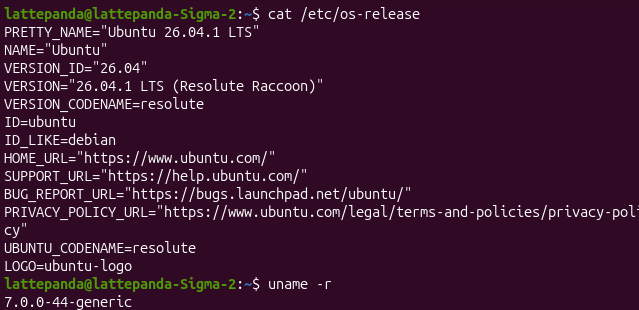
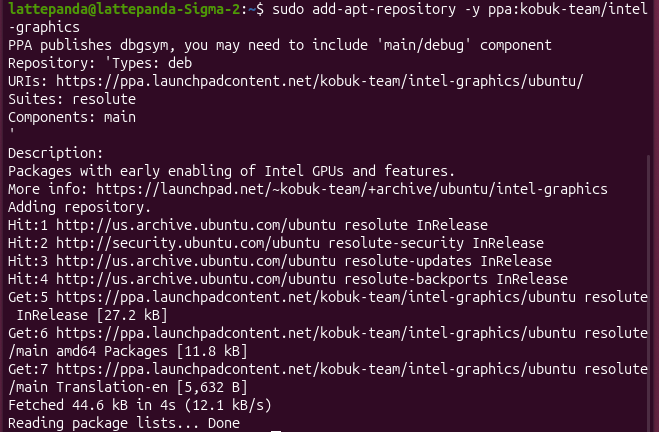
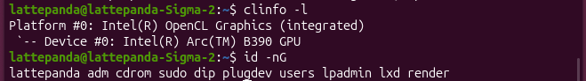
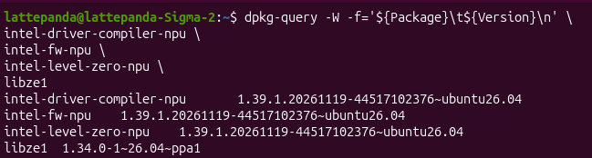
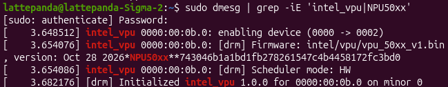

# Linux Installation

The LattePanda Sigma 2 is based on a standard x86 architecture processor, meaning the Linux installation process is identical to that of a regular laptop or desktop computer. It is fully compatible with most mainstream Linux distributions.

!!! note "Pre-installed Ubuntu OS"
    The 1TB SSD that ships with LattePanda Sigma 2 already has Ubuntu 26.04 LTS, GPU/NPU drivers and local AI models pre-installed. You only need this guide if you want to reinstall or install a different Linux distribution.

## Kernel Requirement

The Panther Lake platform requires a recent Linux kernel:

- **Recommended: Linux 7.0 or later** — shipped by default with **Ubuntu 26.04 LTS**, providing the complete support baseline for this platform, including targeted optimizations for the Xe3 integrated graphics and the NPU.
- **Minimum: Linux 6.17** — if you must stay on **Ubuntu 24.04 LTS**, use release 24.04.4 or later and install the HWE kernel stack (the factory 6.8 kernel does not properly support this platform); on a fully updated system this currently provides kernel 7.0:

    ```bash
    sudo apt update
    sudo apt install linux-generic-hwe-24.04
    ```

## General Installation Steps

1. **Download the Linux ISO**

    Visit the official website of your chosen Linux distribution and download the ISO image file. We recommend **Ubuntu 26.04 LTS (Desktop)**.

    [Click to Download Ubuntu Desktop](https://ubuntu.com/download/desktop)

2. **Create a Bootable USB Drive**

    Burn the downloaded ISO image to a USB flash drive. You can use tools like [**Rufus**](https://rufus.ie/) for this purpose.

3. **Boot from the USB Drive**

    Plug the bootable USB drive into your LattePanda Sigma 2, then power on or reboot. Immediately and repeatedly press the **++f7++** key to enter the Boot Device Selection Menu, select your USB flash drive, and press **++enter++**.

    !!! tip
        You can also press **++del++** to enter the BIOS setup and adjust the boot order there.

4. **Install the Operating System**

    Follow the on-screen instructions provided by the Linux installer to partition your M.2 SSD and complete the OS installation.

    !!! warning "Data Loss Warning"
        Installing a new OS will erase the pre-installed Ubuntu system and local AI models on the SSD. Please back up any data you need before proceeding.

5. **Post-Installation & Driver Updates**

    After the installation is complete, if you find that certain peripherals (such as Wi-Fi, Bluetooth, or audio) are not functioning properly, it is usually due to missing drivers in the default kernel.

    - **Update the System**: Run a full system update to fetch the latest packages.
    - **Upgrade the Kernel**: If issues persist, try upgrading to a newer Linux kernel, which often includes better support for newer hardware.
    - **Install Proprietary Drivers**: Some components may require proprietary drivers. Check your distribution's "Additional Drivers" utility.

Intel provides official installation guides and driver releases, which may be updated over time. Refer to the official documentation for the latest packages and release information. The following sections provide Sigma 2-specific installation instructions and verification steps.

!!! note "Tested Configuration"
    These driver steps were tested on Sigma 2 with Ubuntu 26.04.1 and kernel `7.0.0-44-generic`. The Ubuntu 24.04 steps use Intel's corresponding official packages and commands, but were not independently verified in this Sigma 2 test.

    To check your system versions, use `cat /etc/os-release` and `uname -r`.

{width="600"}

## Intel GPU Compute Driver

Linux's default graphics drivers are only responsible for display output and do not include GPU compute libraries (OpenCL / Level Zero).

If you plan to run large language models locally (such as OpenVINO, llama.cpp) or perform other general-purpose GPU computing (such as PyTorch XPU or AI video processing), you need to install the official Intel compute runtime.

Follow the Sigma 2 steps below, or check Intel's [official guide](https://dgpu-docs.intel.com/installation-guides/index.html) for the latest instructions.

1. **Add Intel Graphics PPA**

    Add the [Intel Graphics PPA](https://dgpu-docs.intel.com/installation-guides/installing-packages-from-the-intel-ppa.html):

    ```bash
    sudo apt update
    sudo apt install -y software-properties-common
    sudo add-apt-repository -y ppa:kobuk-team/intel-graphics
    ```

    {width="600"}

2. **Install GPU Compute Runtime**

    ```bash
    sudo apt-get install -y \
        libze-intel-gpu1 \
        libze1 \
        intel-metrics-discovery \
        intel-opencl-icd \
        clinfo \
        intel-gsc
    ```

    | Package | Purpose |
    | :--- | :--- |
    | `libze-intel-gpu1`, `libze1` | Level Zero implementation and loader |
    | `intel-opencl-icd`, `clinfo` | OpenCL runtime and device inspection |
    | `intel-metrics-discovery` | GPU performance metrics |
    | `intel-gsc` | Graphics Security Controller support |

3. **Configure User Permissions**

    Add your user to the `render` group:

    ```bash
    sudo gpasswd -a "$USER" render
    ```

    Log out and log in again, or reboot, to apply the change.

4. **Verify OpenCL Device Detection**

    ```bash
    clinfo -l
    id -nG
    ```

    `clinfo -l` should list `Intel(R) Arc(TM) B390 GPU`, confirming that OpenCL detects the GPU. `id -nG` should include `render`, confirming that group membership is active in the current session:

    {width="600"}

5. **Optional GPU Components**

    Install these only when your application needs them.

    **Media Acceleration** - hardware video decoding and encoding:

    ```bash
    sudo apt-get install -y \
        intel-media-va-driver-non-free \
        libmfx-gen1.2 \
        libvpl2 \
        libvpl-tools \
        libva-glx2 \
        va-driver-all \
        vainfo
    ```

    **AoT Compilation** - development libraries and GPU kernel compilation:

    ```bash
    sudo apt-get install -y libze-dev intel-ocloc
    ```

    **Ray Tracing** - hardware ray tracing support:

    ```bash
    sudo apt-get install -y libze-intel-gpu-raytracing
    ```

## Intel NPU Drivers

See Intel's [official NPU driver releases](https://github.com/intel/linux-npu-driver/releases) for the latest packages. The following steps use [Intel NPU Driver v1.39.1](https://github.com/intel/linux-npu-driver/releases/tag/v1.39.1) and Level Zero Loader **1.34.0**.

!!! note
    If you skipped the GPU setup, run `sudo apt update` and `sudo gpasswd -a "$USER" render` before continuing.

1. **Check Existing Driver**

    ```bash
    dpkg -l | grep -E \
    'intel-driver-compiler-npu|intel-fw-npu|intel-level-zero-npu'
    ```

    If there is no output, continue to the download step. Remove the packages below only when replacing an older NPU driver:

    ```bash
    sudo dpkg --purge --force-remove-reinstreq \
        intel-driver-compiler-npu \
        intel-fw-npu \
        intel-level-zero-npu \
        intel-level-zero-npu-dbgsym
    ```

2. **Download Driver Package**

    ```bash
    mkdir -p ~/npu-driver-v1.39.1
    cd ~/npu-driver-v1.39.1
    ```

    Select your Ubuntu version:

    === "Ubuntu 24.04"

        ```bash
        wget https://github.com/intel/linux-npu-driver/releases/download/v1.39.1/linux-npu-driver-v1.39.1.20261119-44517102376-ubuntu2404.tar.gz
        tar -xf linux-npu-driver-v1.39.1.20261119-44517102376-ubuntu2404.tar.gz
        ```

    === "Ubuntu 26.04"

        ```bash
        wget https://github.com/intel/linux-npu-driver/releases/download/v1.39.1/linux-npu-driver-v1.39.1.20261119-44517102376-ubuntu2604.tar.gz
        tar -xf linux-npu-driver-v1.39.1.20261119-44517102376-ubuntu2604.tar.gz
        ```

3. **Install NPU Driver**

    Install the dependency, then run the package installation from the directory containing the extracted `.deb` files:

    ```bash
    sudo apt install -y libtbb12
    sudo dpkg -i ./*.deb
    ```

4. **Install Matching Level Zero Loader**

    Use the package matching your Ubuntu version:

    === "Ubuntu 24.04"

        ```bash
        wget https://snapshot.ppa.launchpadcontent.net/kobuk-team/intel-graphics/ubuntu/20261110T100000Z/pool/main/l/level-zero-loader/libze1_1.34.0-1~24.04~ppa1_amd64.deb
        sudo dpkg -i ./libze1_1.34.0-1~24.04~ppa1_amd64.deb
        ```

    === "Ubuntu 26.04"

        ```bash
        wget https://snapshot.ppa.launchpadcontent.net/kobuk-team/intel-graphics/ubuntu/20261110T100000Z/pool/main/l/level-zero-loader/libze1_1.34.0-1~26.04~ppa1_amd64.deb
        sudo dpkg -i ./libze1_1.34.0-1~26.04~ppa1_amd64.deb
        ```

5. **Configure Permissions and Reboot**

    Reboot to apply the driver and permission changes:

    ```bash
    sudo reboot
    ```

6. **Verify NPU Initialization**

    After reboot, check that the NPU device node exists:

    ```bash
    ls /dev/accel/accel0
    ```

    The output should be `/dev/accel/accel0`, confirming that the NPU device node is present:

    {width="600"}

    Check the installed versions:

    ```bash
    dpkg-query -W -f='${Package}\t${Version}\n' \
        intel-driver-compiler-npu \
        intel-fw-npu \
        intel-level-zero-npu \
        libze1
    ```

    The three NPU packages should show version `1.39.1`, and `libze1` should show `1.34.0`. Build and Ubuntu release suffixes may differ:

    {width="600"}

    Check driver initialization:

    ```bash
    sudo dmesg | grep -iE 'intel_vpu|NPU50xx'
    ```

    The log should show a `Firmware:` entry and `Initialized intel_vpu`, confirming driver initialization. The tested firmware date is `Oct 28 2026`:

    {width="600"}

    If the device node is missing, check the kernel version, installed packages, and `intel_vpu` messages.

------

[**:simple-discord: Join our Discord**](https://discord.gg/k6YPYQgmHt){ .md-button .md-button--primary }
